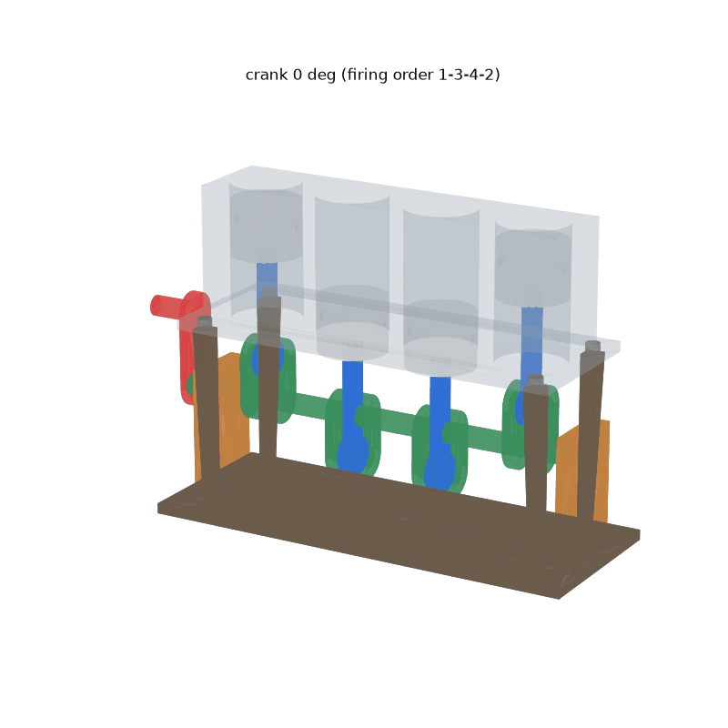

# 손으로 돌리는 4기통 엔진 원리 모형 + 검증 파이프라인



## 명령 하나

```bash
make
```

`요청>` 입력란이 나온다. 바꾸고 싶은 점을 적으면 다음을 반복한다:

1. Claude 가 `engine/make_engine.py` 를 고친다 (`claude -p`, 도구 없이 코드만 생성)
2. CadQuery 로 부품 생성 → 검증 0~7단계
3. 실패하면 실패 줄을 붙여 다시 요청 (최대 3회, `MAX_TRIES=5 make` 로 변경)
4. 통과하면 그림 생성. 3회 모두 실패하면 원래 설계로 되돌림

매 시도는 `prompts/log.csv` 에 한 줄씩 자동 기록되고, 시도한 코드는 `prompts/attempts/` 에 남는다. 빈 줄을 입력하면 AI 없이 현재 설계로 생성, 검증, 그림만 한다.

예: `크랭크축이 앞뒤로 움직이는 문제를 고정 칼라로 막아줘`, `피스톤 지름을 24mm 로 키워줘`

| 명령 | 하는 일 |
|---|---|
| `make check` | AI 없이 생성 → 검증 → 그림 |
| `make build` | `engine/make_engine.py` 로 `parts/*.step`, `parts/*.stl`, `parts/assembly.json` 생성 |
| `make verify` | `uv run verify.py`, 모든 단계 검증 (`--skip 6,7` 로 단계 건너뛰기) |
| `make render` | `reports/engine.png`, `reports/engine.gif` 생성 |
| `make test` | 일부러 망가뜨린 엔진 4종을 검증기가 잡는지 확인 |

AI 가 만든 코드는 이 PC 에서 그대로 실행된다. 결과는 `git diff` 로 확인하고 커밋한다.

준비물: [uv](https://docs.astral.sh/uv/) (파이썬 패키지는 자동 설치), 로그인된 [Claude Code](https://claude.com/claude-code) CLI (`make` 의 AI 단계), 6단계용 `brew install --cask prusaslicer` (없으면 6단계는 SKIP).

## 검증 단계

| 단계 | 검사 | 기준 (`rules.toml`) |
|---|---|---|
| 0 파일 | 기능 부품은 STEP+STL, 겉면 부품은 STL | 과제 "파일" 조건 |
| 0 프롬프트 기록 | `prompts/log.csv` 가 있는지, 모든 부품이 기록에 있는지 | 과제 "프롬프트 기록" 조건 |
| 1 형상 규칙 | 200mm 이내, 닫힌 메쉬, 벽 두께 (표면 3000점에서 안쪽으로 광선을 쏴서 측정) | 벽 1.6 (장식 1.2) |
| 2 출력성 | 6방향 중 오버행이 가장 작은 출력 방향을 고르고, 45° 넘는 아랫면 면적을 계산 | 서포트가 필요하면 `support_note` 에 위치를 적어야 통과 |
| 3 결합 공차 | 결합 위치의 단면에서 핀과 구멍 지름을 직접 재서 차이를 확인 | running 0.2~0.5, sliding 0.3~0.7, press −0.15~0, locating 0.1~0.3, 핀 지름 3 이상 |
| 4 조립 간섭 | 0°에서 모든 부품 쌍이 겹치는 부피 (압입 쌍은 제외) | 0.5mm³ 이하 |
| 5 동작 검사 | 크랭크를 5° 간격으로 한 바퀴 돌리며 움직이는 부품끼리 충돌 확인 | 로드/반경 3 이상 |
| 6 슬라이서 | PrusaSlicer로 2단계 방향 그대로 슬라이스, 출력 시간과 필라멘트 양 | 슬라이스 성공 |
| 7 실물 측정 | `measurements.csv` 의 캘리퍼 측정값과 설계값 비교 | 행마다 허용오차 |

## 핵심 치수

| 항목 | 값 |
|---|---|
| 보어 / 피스톤 | 20.5 / 20.0 |
| 행정 (크랭크 반경) | 24 (12) |
| 커넥팅 로드 중심거리 | 40 (로드/반경 3.33) |
| 실린더 간격 | 28 |
| 크랭크핀 위상 | 0°, 180°, 180°, 0° (점화순서 1-3-4-2) |
| 크랭크핀, 저널 | ⌀6, 웹 구멍 ⌀5.95 (압입), 로드와 베어링 구멍 ⌀6.4 |
| 피스톤 핀 | ⌀4, 피스톤 구멍 ⌀3.95 (압입), 로드 구멍 ⌀4.4 |

부품 37개: 블록, 커버(투명), 받침, 베어링 블록 2, 손잡이, 저널 5, 웹 8, 크랭크핀 4, 고정 칼라 2, 로드 4, 피스톤 4, 피스톤 핀 4. 결합 45곳. 크랭크축 축 방향 유격 최대 0.28. 못, 나사, 접착제 없이 핀과 압입으로만 조립한다.

## 다른 도구로 만든 부품을 검증하려면

`parts/` 에 `<이름>.stl` (기능 부품은 `.step` 도 함께)과 `assembly.json` 을 둔다. 좌표 규칙: 크랭크축은 원점을 지나는 X축, 실린더는 +Z 방향, 모든 부품은 크랭크 0°(1번 실린더 상사점)의 조립 위치에 둔다.

```json
{
  "kinematics": {"r": 12, "L": 40, "cylinders": [{"id": 1, "x": -42, "phase": 0}]},
  "parts": [{"name": "rod_1", "type": "functional", "motion": "rod:1"}],
  "fits": [{"name": "crankpin_1 / rod_1", "pin": "crankpin_1", "hole": "rod_1",
            "at": [-42, 0, 12], "axis": "x", "kind": "running"}]
}
```

`motion` 값: `fixed` / `crank` / `rod:<번호>` / `piston:<번호>`. 부품에 `"decor": true` 를 넣으면 벽 기준이 1.2가 되고, `"support_note": "..."` 를 넣으면 서포트 위치를 적은 것으로 본다.

## 기록

- `prompts/log.csv`: 프롬프트, 첨부, 결과 (실패한 시도 포함)
- `measurements.csv`: 출력 후 캘리퍼 측정값
