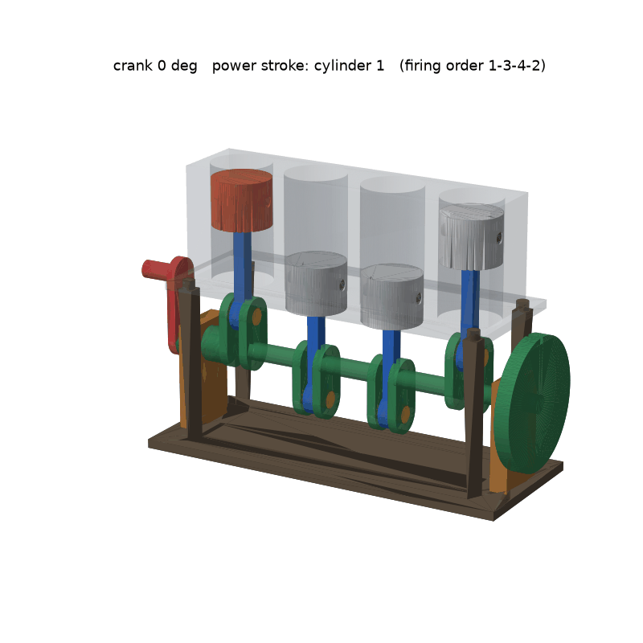

# 손으로 돌리는 4기통 엔진 원리 모형: 프롬프트 → 생성 → 검증 파이프라인

엔진은 들어 있지 않다. 팀이 프롬프트를 넣어 처음부터 만든다.



*검증기 테스트용 참고 엔진 (`tests/reference_engine.py`), 크랭크 1회전. 노란색이 크랭크핀*

## 명령 하나

```bash
make
```

`요청>` 입력란이 나온다.

- `engine/make_engine.py` 가 없으면 첫 요청으로 **처음부터** 만든다
- 있으면 요청대로 **고친다** (빈 줄 = AI 없이 현재 설계로 검증만)

그다음 반복:

1. Claude 가 `engine/make_engine.py` 를 쓴다 (`claude -p`, 도구 없이 코드만 생성)
2. CadQuery 로 부품 생성 → 검증 0~7단계
3. 실패하면 문제 분석을 붙여 다시 요청 (최대 3회, `MAX_TRIES=5 make` 로 변경)
4. 통과하면 그림 생성. 모두 실패하면 요청 전 상태로 되돌림
5. 마지막에 **첫 시도 분석** 출력: 처음 만든 결과가 어떤 기준을 어겼는지, 측정값, 위치, 고칠 값. `reports/first_attempt.md` 에도 저장

```
==== 첫 시도 분석 ====
요청: ...
[3. 결합 공차] 10건
  FAIL crankpin_1 / rod_1 외 5개: running 차이 +0.10 가 기준 +0.20~+0.50 밖(빡빡함). 핀 ⌀6.00 그대로면 구멍을 ⌀6.10 → ⌀6.35 로 바꿀 것
[5. 동작 검사] 1건
  FAIL block x rod_2: 크랭크 95°에서 처음 부딪힘, 최대 24.0mm3, 위치 약 (-14, 11, 11). ...
결과: 2회차에서 통과
```

매 시도는 `prompts/log.csv` 에 한 줄씩 자동 기록되고 (실패 포함), 시도한 코드는 `prompts/attempts/` 에 남는다.

| 명령 | 하는 일 |
|---|---|
| `make check` | AI 없이 생성 → 검증 → 그림 |
| `make build` | `engine/make_engine.py` 로 `parts/*.step`, `parts/*.stl`, `parts/assembly.json` 생성 |
| `make verify` | `uv run verify.py`, 모든 단계 검증 (`--skip 6,7` 로 단계 건너뛰기) |
| `make render` | `reports/engine.png`, `reports/engine.gif` 생성 (크랭크 10° 간격 1회전) |
| `make test` | 검증기 자체 테스트: 참고 엔진은 통과, 일부러 망가뜨린 4종은 FAIL 인지 |
| `make clean` | 결과물(`parts/`, `reports/`) 삭제. `make check` 로 다시 만들 수 있음 |
| `make reset` | 처음 상태로: 엔진 코드, `prompts/log.csv`, `prompts/attempts/` 까지 삭제 (y 확인) |

AI 가 만든 코드는 이 PC 에서 그대로 실행된다. 결과는 `git diff` 로 확인하고 커밋한다. 검증은 규칙 위반만 잡고, 요청대로 바뀌었는지는 사람이 확인해야 한다.

준비물: [uv](https://docs.astral.sh/uv/) (파이썬 패키지는 자동 설치), 로그인된 [Claude Code](https://claude.com/claude-code) CLI (각자 계정으로 실행), 6단계용 `brew install --cask prusaslicer` (없으면 6단계는 SKIP).

## 검증 단계

| 단계 | 검사 | 기준 (`rules.toml`) |
|---|---|---|
| 0 파일 | 기능 부품은 STEP+STL, 겉면 부품은 STL | 과제 "파일" 조건 |
| 0 프롬프트 기록 | `prompts/log.csv` 가 있는지, 모든 부품이 기록에 있는지 | 과제 "프롬프트 기록" 조건 |
| 1 형상 규칙 | 200mm 이내, 닫힌 메쉬, 벽 두께 (표면 3000점에서 안쪽으로 광선을 쏴서 측정) | 벽 1.6 (장식 1.2) |
| 2 출력성 | 6방향 중 오버행이 가장 작은 출력 방향을 고르고, 45° 넘는 아랫면 면적을 계산 | 서포트가 필요하면 `support_note` 에 위치를 적어야 통과 |
| 3 결합 공차 | 결합 위치의 단면에서 핀과 구멍 지름을 직접 재서 차이를 확인 | running 0.2~0.5, sliding 0.3~0.7, press −0.15~0, locating 0.1~0.3, 핀 지름 3 이상 |
| 4 조립 간섭 | 0°에서 모든 부품 쌍이 겹치는 부피 (압입 쌍은 제외) | 0.5mm³ 이하 |
| 5 동작 검사 | 크랭크를 5° 간격으로 한 바퀴 돌리며 움직이는 부품끼리 충돌 확인 | 로드/반경 3 이상 |
| 6 슬라이서 | PrusaSlicer로 2단계 방향 그대로 슬라이스, 출력 시간과 필라멘트 양 | 슬라이스 성공 |
| 7 실물 측정 | `measurements.csv` 의 캘리퍼 측정값과 설계값 비교 | 행마다 허용오차 |

## 참고 엔진 (검증기 테스트용)

`tests/reference_engine.py` 는 검증기를 만들면서 쓴 엔진이다 (부품 38개, 플라이휠 포함). `make test` 가 이걸 일부러 망가뜨려 검증기가 잡는지 확인하는 데만 쓴다. 이 엔진의 프롬프트 기록은 `tests/reference_log.csv`.

## 다른 도구로 만든 부품을 검증하려면

`parts/` 에 `<이름>.stl` (기능 부품은 `.step` 도 함께)과 `assembly.json` 을 둔다. 좌표 규칙: 크랭크축은 원점을 지나는 X축, 실린더는 +Z 방향, 모든 부품은 크랭크 0°(1번 실린더 상사점)의 조립 위치에 둔다.

```json
{
  "kinematics": {"r": 12, "L": 40, "cylinders": [{"id": 1, "x": -42, "phase": 0}]},
  "parts": [{"name": "rod_1", "type": "functional", "motion": "rod:1"}],
  "fits": [{"name": "crankpin_1 / rod_1", "pin": "crankpin_1", "hole": "rod_1",
            "at": [-42, 0, 12], "axis": "x", "kind": "running"}]
}
```

`motion` 값: `fixed` / `crank` / `rod:<번호>` / `piston:<번호>`. 부품에 `"decor": true` 를 넣으면 벽 기준이 1.2가 되고, `"support_note": "..."` 를 넣으면 서포트 위치를 적은 것으로 본다.

## 기록

- `prompts/log.csv`: 프롬프트, 첨부, 결과 (실패한 시도 포함)
- `measurements.csv`: 출력 후 캘리퍼 측정값
